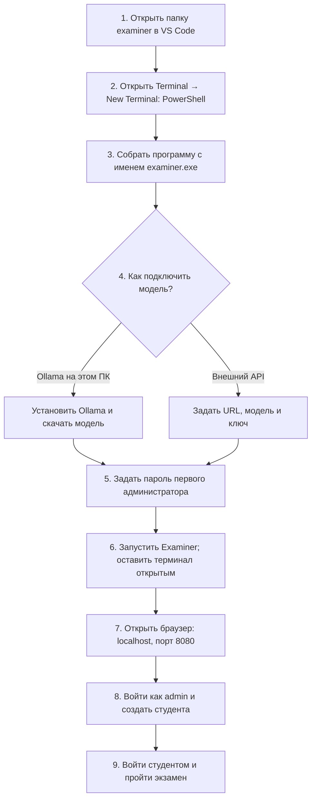

# Первый запуск Examiner: от VS Code до экзамена в браузере

Для Windows 10/11 и VS Code. Маршрут добавлен по запросу U-002.
[Общее руководство](user-guide-ru.md) · [Журнал изменений](work-log-ru.md)

Сначала получите копию и установите инструменты по общему руководству.
Если папка examiner уже скачана, повторный clone не нужен.
Ниже сервер запускается на вашем ПК; облачную среду эти команды не запускают.

## Карта запуска



Схема отображается при просмотре этого Markdown-файла на GitHub.
Это схема действий, а не снимок уже запущенного приложения.

## Что должно быть открыто

| Окно | Что в нём происходит | Когда закрывать |
| --- | --- | --- |
| VS Code, папка examiner | Код и терминалы PowerShell | После остановки приложения |
| Приложение Ollama, если выбран локальный вариант | Обслуживает запросы к модели | После завершения эксперимента |
| Браузер | Страницы входа, экзамена и результатов | Можно закрыть независимо от сервера |

Терминал с запущенным Examiner остаётся занят программой. Для дополнительных
команд используйте кнопку «+» в панели терминала: она откроет второй терминал.

## 1. Открыть проект и проверить инструменты

В VS Code: File → Open Folder → выбрать папку examiner.
Затем Terminal → New Terminal. В списке профилей терминала выбрать PowerShell.
Ввести по очереди:

```powershell
Get-Location
Test-Path .\go.mod
go version
$env:Path += ";$(go env GOPATH)\bin"
templ --version
task --version
```

Ожидается: адрес папки examiner, True, версии Go, Templ и Task.
Если Test-Path вернул False, открыта другая папка. Если команда инструмента
не найдена, вернитесь к разделу его установки в общем руководстве.

## 2. Собрать программу

```powershell
go mod download
task build BINARY=bin/examiner.exe
Test-Path .\bin\examiner.exe
```

Последняя команда должна вернуть True. Это проверка сборки, а не запуска
сервера. Проверки программы запускаются отдельно через task test.
Ранее пользователь сообщил о двух ошибках golden-тестов: их диагностика
описана в общем руководстве, и результат на его ПК ещё не подтверждён.

Почему имя задано явно: в Taskfile.yml по умолчанию указано BINARY: bin/examiner.
При явном имени результата через go build -o расширение .exe автоматически
не добавляется. Поэтому прежняя команда task build могла создать файл examiner
без расширения, а проверка examiner.exe возвращала False. Это ошибка предыдущей
редакции инструкции. BINARY=bin/examiner.exe переопределяет имя при выполнении
команды и не редактирует Taskfile.yml. Повторная сборка создаст нужный файл;
переименовывать результат вручную не требуется.

## 3. Подключить модель: выбрать один вариант

### Вариант А: Ollama на этом же компьютере

Установить Ollama с официального сайта https://ollama.com/download/windows.
Проверить требования к поддерживаемой версии Windows и ресурсам на сайте.
Скачивание модели требует места на диске; скорость работы зависит от компьютера.
Открыть приложение Ollama и после установки открыть новый терминал PowerShell:

```powershell
ollama --version
ollama pull llama3.2
ollama list
Invoke-RestMethod -Uri "http://localhost:11434/v1/models"
```

Ожидается: модель llama3.2 в списке и ответ API со списком моделей.
Команда pull скачивает модель и может занять время. Если API недоступен,
сначала запустить или проверить Ollama, а не пытаться запускать Examiner повторно.

В том терминале, где будет запущен Examiner, задать:

```powershell
$env:EXAMINER_LLM_URL = "http://localhost:11434/v1"
$env:EXAMINER_LLM_MODEL = "llama3.2"
$env:EXAMINER_LLM_KEY = "ollama"
```

Значение ollama — стандартное значение для этого локального подключения,
не ключ внешнего сервиса. localhost:11434 обслуживает модель;
это не адрес страницы Examiner.

### Вариант Б: внешний OpenAI-совместимый API

У провайдера узнать базовый URL API, точный идентификатор модели и ключ.
В PowerShell выполнить команды ниже. Каждая запросит значение с клавиатуры:

```powershell
$env:EXAMINER_LLM_URL = Read-Host "Базовый URL API от провайдера"
$env:EXAMINER_LLM_MODEL = Read-Host "Идентификатор модели"
$env:EXAMINER_LLM_KEY = [System.Net.NetworkCredential]::new("", (Read-Host "Ключ API" -AsSecureString)).Password
```

При вводе ключа символы скрыты; сама переменная нужна программе в открытом виде
в памяти процесса. Не выводить её в терминал и не добавлять ключ в Git.
Ключ API и пароль администратора — разные данные. Вызовы API могут оплачиваться.
Провайдер должен поддерживать запрос списка моделей, который Examiner делает
при старте, и используемый приложением протокол чата.

## 4. Задать пароль администратора

В том же терминале, где заданы настройки модели:

```powershell
$env:EXAMINER_ADMIN_PASSWORD = [System.Net.NetworkCredential]::new("", (Read-Host "Придумайте пароль admin" -AsSecureString)).Password
```

Введите свой пароль и сохраните его у себя. В команде пароль не записан,
поэтому он не попадёт в текст истории команд. Не используйте пароль GitHub.
Эта настройка создаёт первого администратора только при пустой таблице пользователей.
Если база уже использовалась, ввод другого значения не изменит прежний пароль.

## 5. Запустить сервер

Из папки examiner, в том же терминале:

```powershell
task run BINARY=bin/examiner.exe -- --addr 127.0.0.1:8080 --lang ru --questions questions/physics_ru.json --num-questions 2 --secure-cookies=false
```

Это запускает короткий экзамен на русском. task run при необходимости собирает
приложение с тем же явно заданным именем .exe, затем запускает сервер.
BINARY=bin/examiner.exe нужно указывать и при сборке, и при запуске.
После успешной инициализации ожидается
сообщение starting server с адресом 127.0.0.1:8080. Если сразу появилась ошибка
или приглашение PowerShell вернулось, сервер не продолжает работать.
Сообщение о запуске проверяется вместе с открытием страницы в следующем шаге.

```text
Окно VS Code — терминал PowerShell
┌─────────────────────────────────────────────────────────────┐
│ ... LLM endpoint OK ...                                     │
│ ... starting server ... addr=127.0.0.1:8080 ...               │
│ ▌ программа продолжает работать; это окно оставляем открытым │
└─────────────────────────────────────────────────────────────┘
                         ↓ открыть браузер
```

Выше условный пример сообщений, не снимок экрана и не доказательство запуска.

## 6. Увидеть приложение

Открыть Edge, Chrome или Firefox. В адресную строку ввести:

```text
http://localhost:8080
```

Этот адрес открывается на вашем Windows-ПК после локального запуска.
Он не ведёт к копии в облачном чате. Страница должна перенаправить на вход.

```text
Браузер — условная схема страницы
┌──────────────────────────────────────────┐
│ Адрес: http://localhost:8080/login        │
├──────────────────────────────────────────┤
│ Вход                                     │
│ Имя пользователя: admin                  │
│ Пароль: ваш пароль из шага 4              │
│                [ кнопка входа ]          │
└──────────────────────────────────────────┘
```

Войти как admin. Открыть «Администрирование» → «Управление пользователями».
Создать тестового пользователя, например student1, с ролью student и своим
тестовым паролем. Выйти через «Выход» и войти как student1. На главной выбрать
тему, если предлагается выбор, и нажать «Начать экзамен». Ответить на вопросы,
дождаться обратной связи модели и завершить экзамен. Для преподавательской
проверки войти администратором и открыть панель проверки.

Страница входа подтверждает работу веб-сервера. Ответ модели и результат
экзамена отдельно подтверждают работу связки с LLM.

## 7. Остановить и запустить снова

В терминале сервера нажать Ctrl+C. Браузер сам программу не останавливает.
Данные остаются в examiner.db. Не удалять базу ради обычного перезапуска.
Повторить полную команду task run BINARY=bin/examiner.exe из шага 5
в том же терминале. В новом терминале переменные
модели и ключа нужно задать заново; переменные из этой инструкции не сохраняются
постоянно. Для используемой базы нужен уже существующий пароль admin.

## Если не получилось

| Что видно | Что проверить |
| --- | --- |
| task или templ не найдены | Установка инструмента и Path текущего терминала |
| admin password is required | Шаг 4 выполнен в том же терминале |
| LLM health check / endpoint unreachable | Ollama запущена или верны URL, доступ и ключ API |
| Ошибка неизвестной модели при ответе | Точное имя модели у провайдера или в ollama list |
| Браузер не соединяется | Сервер ещё работает; не было ошибки запуска; порт совпадает |
| Порт 8080 занят | Остановить свою предыдущую копию или использовать --addr 127.0.0.1:8081 и порт 8081 в браузере |
| После входа снова страница входа | Запуск с --secure-cookies=false для локального HTTP |
| Пароль admin не подходит | Каким паролем создана уже существующая база; изменение переменной его не сбрасывает |
| «Неверное имя пользователя или пароль» после выхода | Проверить имя admin, первоначальный пароль, раскладку и активность учётной записи; подробнее ниже |
| Страница без оформления или действия не обновляются | Доступ браузера к CDN cdn.jsdelivr.net и unpkg.com |

### Если после выхода не удаётся снова войти как admin

В U-004 пользователь подтвердил нажатие «Переключить» в строке admin:
учётная запись оказалась отключена. Исправление и команда восстановления
готовы в [PR #2](https://github.com/Fail-404/examiner/pull/2).
Пройдите [восстановление активности с сохранением пароля и базы](https://github.com/Fail-404/examiner/blob/fix/admin-self-deactivation-u004/docs/development/admin-access-recovery-ru.md).
Новая команда есть в ветке fix/admin-self-deactivation-u004; до слияния
одного обновления main для её получения недостаточно.

Выход завершает текущую сессию. При проверке в отдельной тестовой базе он
не изменил пароль, имя или активность администратора. На конкретном ПК
причина ошибки может отличаться; сообщение само по себе не доказывает,
что пароль повреждён или что есть ошибка обработки выхода.

1. В поле имени ввести именно admin. Отображаемое имя Administrator, email
   и имя аккаунта GitHub не заменяют имя пользователя приложения.
2. Ввести тот пароль, с которым первый вход действительно удался.
   Проверить раскладку и Caps Lock, исключить подстановку другого пароля браузером.
   Пароль вводится только в локальном браузере; отправлять его помощнику не нужно.
3. Если после первого запуска менялись EXAMINER_ADMIN_PASSWORD или
   --admin-password, сохранённый пароль от этого не изменился.
   Эти настройки используются при создании первого пользователя в пустой базе.
4. Если в управлении пользователями меняли активность admin, сообщить об этом.
   Отключённый пользователь получает то же сообщение, что и при неверном пароле.
   При наличии другой активной учётной записи администратора проверить статус
   через неё. Наличие такой учётной записи не предполагается автоматически.
5. При дальнейшей диагностике указать: тот ли пароль и имя использованы,
   был ли перезапуск и какая команда запуска применялась. Ключи и пароли
   из команды перед отправкой убрать. Удалять или заменять examiner.db
   для этой проверки не требуется: в ней находятся и другие данные приложения.

Если первоначальный пароль утрачен или единственный администратор отключён,
нужен отдельный способ восстановления доступа с сохранением базы. Простая
смена переменной окружения или повторная сборка программы этого не выполняют.
Для отключённого администратора используйте описанную выше команду
reactivate-admin из исправленной версии. Она не сбрасывает забытый пароль.

При обращении за помощью достаточно указать номер шага и текст ошибки без
ключей, паролей и cookies. Это руководство сверено с кодом и настройками
репозитория; полный сценарий на Windows-ПК пользователя ещё не выполнен помощником.
